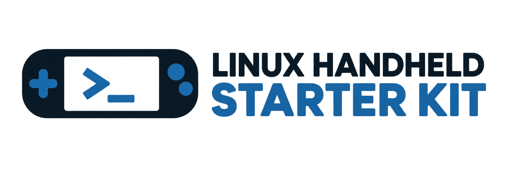

<p align="center"><a href="https://linux-handheld-starter-kit.cocoabloom514.chatgpt.site/"></a></p>

<p align="center"><a href="https://www.youtube.com/@SteamDeckChecker/"></a></p>

# Linux Handheld Starter Kit

Guided first-time setup for Linux handhelds running
[SteamOS](https://store.steampowered.com/steamos/),
[CachyOS](https://cachyos.org/) or [Bazzite](https://bazzite.gg/).

[Deutsch](README.md) · [Website](https://linux-handheld-starter-kit.cocoabloom514.chatgpt.site/en/) · [Releases](https://github.com/Steamdeckchecker/LinuxGamingStarterKit/releases) · [YouTube](https://www.youtube.com/@SteamDeckChecker/) · [Changelog](CHANGELOG.md)

**v0.1.0 is an initial public test release.** Automated tests cover the core
logic with simulated system commands. Tests have been carried out on SteamOS, CachyOS and Bazzite. Third-party apps and
plugins have their own Steam, distribution and hardware requirements.

## Video tutorial

[](https://youtu.be/bLE9qumR9XI)

[Watch the video tutorial on YouTube](https://youtu.be/bLE9qumR9XI)

## Download and start

| Download | Use |
| --- | --- |
| [Linux-Handheld-Starter-Kit.desktop](https://github.com/Steamdeckchecker/LinuxGamingStarterKit/releases/download/v0.1.0/Linux-Handheld-Starter-Kit.desktop) | Recommended: a single double-click launcher containing the complete installer. |
| [install.sh](https://github.com/Steamdeckchecker/LinuxGamingStarterKit/releases/download/v0.1.0/install.sh) | Alternative standalone terminal installer. |
| [Source ZIP](https://github.com/Steamdeckchecker/LinuxGamingStarterKit/releases/download/v0.1.0/Linux-Handheld-Starter-Kit-v0.1.0.zip) | Both launchers, editable sources, website, documentation and tests. |
| [SHA256SUMS](https://github.com/Steamdeckchecker/LinuxGamingStarterKit/releases/download/v0.1.0/SHA256SUMS) | SHA-256 checksums for the three downloads above. |

Switch to **Desktop Mode**, download the `.desktop` file and double-click it.
KDE may require a one-time permission: right-click → Properties → Permissions
→ mark executable, then confirm execution/trust if prompted. Browsers may
remove the executable bit when downloading.

The desktop launcher verifies its embedded installer hash, extracts it into a
private temporary directory, opens a terminal and waits for setup to end before
cleaning up. It does not download another Starter Kit file at runtime.
Your selected apps/plugins are downloaded during setup.

**Alternatively: download and start with one terminal command**

In **Desktop Mode**, run the following as your normal user. Use the code block's
copy button to copy the complete command:

```bash
curl -fL --retry 3 -o install.sh "https://github.com/Steamdeckchecker/LinuxGamingStarterKit/releases/download/v0.1.0/install.sh" && bash install.sh
```

This saves version **0.1.0** as `install.sh` in the current directory and starts
it only after the download succeeds. **Do not prefix it with sudo**; the wizard
asks for administrator authorization when needed. If you have already downloaded
the script, simply run `bash install.sh`.
You do not need to clone this repository or install Python packages.

## Requirements and languages

- x86_64 Linux, Bash, Python **3.9+**, a graphical desktop session and Internet.
- **Zenity or KDialog** for the GUI; Konsole, GNOME Terminal or xterm for password setup.
- `sudo`, `curl`, `jq`, `getent` and `systemctl` for Decky; `flatpak` for apps.
- An initialized Steam installation for Decky and Steam library shortcuts.

The installer reports missing system tools. It does not unlock SteamOS or
automatically upgrade the whole distribution.

Choose **Deutsch, English, Español, Français, Русский, 简体中文 or 日本語** at
startup. Built-in dialogs, buttons and app descriptions are translated.
External installer output and plugin catalogue descriptions retain their
original language. The system language is unchanged.

## Guided workflow

| Step | What happens |
| --- | --- |
| Language | Choose the language for this run. |
| 1. Device | Steam Deck LCD, Steam Deck OLED, Steam Machine, MSI Claw, Legion Go or another handheld. |
| 2. Password | Offer password setup via the native `passwd` tool if no password is present. |
| 3. Authorization | Ask for the password again to authorize sudo operations. |
| 4. Startup movies | Preselect the matching device pack; choose any of the six packs or skip. |
| 5. Decky | Offer the official stable Decky Loader; declining skips plugins. |
| 6. Plugins | Install the 23 built-in recommendations, choose from a searchable catalogue sorted by GitHub stars, or skip. |
| 7. Apps | Select optional Flatpaks, install them sequentially and offer Steam shortcuts. |
| 8. Emulation | Choose RetroDECK, EmuDeck or neither; offer a Steam shortcut afterward. |
| 9–10. Finish | Show results, offer reboot and exit. Reboot happens only after choosing Yes. |

Every download, extraction and installation completes before the next task
starts. The terminal shows progress, transfer rates where known, elapsed time
and external installer output. Failures are reported and never counted as
successful installations; later optional tasks can continue.

Passwords are passed to `sudo` through standard input, never written to logs or
retained for later commands. Sudo's temporary authorization is refreshed during
the run and revoked on exit. The Decky authorization fix uses separate
`sudo -k` and `sudo -S -v` operations.

## Startup movies

The startup movies include our own creations as well as videos from
[steamdeckrepo.com](https://steamdeckrepo.com/).

| Device | Repository |
| --- | --- |
| Steam Deck LCD | [SVSDLCD](https://github.com/Steamdeckchecker/SVSDLCD) |
| Steam Deck OLED | [SVSDOLED](https://github.com/Steamdeckchecker/SVSDOLED) |
| Steam Machine | [SVSM](https://github.com/Steamdeckchecker/SVSM) |
| MSI Claw | [SVMSICLAW](https://github.com/Steamdeckchecker/SVMSICLAW) |
| Legion Go / Go 2 | [SVLLGO](https://github.com/Steamdeckchecker/SVLLGO) |
| Other handheld | [SVOTHER](https://github.com/Steamdeckchecker/SVOTHER) |

Only WebM movies are copied. Missing directories are created and matching
filenames are replaced; other existing movies remain. The normal Steam Deck
destination is `/home/deck/.steam/root/config/uioverrides/movies/`. Other user
homes and common Flatpak Steam paths are detected automatically.

After installation enable them in **Game Mode → Settings → Customization →
Startup Movie**. Exact menu wording depends on Steam language/version.

## Decky plugins

[Decky Loader](https://decky.xyz/) uses its official CLI installer. All 23
repository recommendations are embedded in both launchers; `recommend.txt`
exists for source maintenance. Rebuild with `python3 build.py` after editing it.
Use `--recommend /path/recommend.txt` to override the list for one run.

The free-selection catalogue comes from the
[Decky Plugins Explorer](https://safetzahirovic.github.io/decky-plugins-explorer/).
It supports searching names, repositories and descriptions and sorts by stars.
Plugin packages are taken from release assets, the official store with an
exact name/author match and hash validation, or an already-built repository
archive. Raw frontend source without a built plugin is reported and skipped.
Existing plugin versions are backed up in `~/homebrew/.starter-kit-backups/`.

GitHub API limits apply. Optional `GH_TOKEN` or `GITHUB_TOKEN` environment
variables are sent only to the GitHub API, not to download redirect hosts, and
are not saved in files or logs.

## Optional apps and Steam shortcuts

Heroic, ProtonUp-Qt, Proton Plus, VacuumTube, Lutris, Moonlight, Chiaki4deck /
chiaki-ng, GeForce NOW, XStreaming, Flatseal, Filelight, Discord, Google Chrome,
LibreOffice, SuperTuxKart and Dr. Robotnik's Ring Racers are offered as Flatpaks.
They are installed per user; existing user/system installations are reused.
Flathub is added if needed. GeForce NOW uses NVIDIA's official Flatpak remote
and installs the app after adding the remote.

Steam shortcuts are optional. The wizard asks Steam to close and waits for it
to stop fully before touching library files. With multiple local accounts it
asks which account to use. It backs up `shortcuts.vdf`, preserves existing
entries and avoids duplicate Flatpak shortcuts. After saving it waits **three
seconds** and restarts Steam as the desktop user. It waits for Steam to start,
not for the restarted window to close.

## Emulation

[RetroDECK](https://retrodeck.net/) is installed as the user Flatpak
`net.retrodeck.retrodeck`; complete its first-run setup later inside the app.

[EmuDeck](https://www.emudeck.com/) uses the official AppImage from
`EmuDeck/emudeck-electron`, saved to `~/Applications/EmuDeck.AppImage` and run
with `APPIMAGE_EXTRACT_AND_RUN=1`. Finish setup in its official wizard, then
close that window. The Starter Kit waits for the process to exit. Closing
without setup does not establish a fully configured emulation installation.

Each choice offers its own Steam shortcut afterward, using the same safe
shutdown/save/three-second-wait/restart sequence. No ROMs or BIOS files are included.

## Diagnostics, development and website

```bash
bash install.sh --check
bash install.sh --dry-run
bash install.sh --lang en
python3 -m unittest discover -s tests -v
python3 build.py
```

Logs and result summaries are stored under
`~/.local/state/linux-handheld-starter-kit/`. `--check` reports prerequisites
and detected paths. `--dry-run` simulates setup without installations, password
changes or reboot; a selected external plugin catalogue may still be read.

The [website sources](website/README.md) include seven language versions and
the latest **nine** channel videos. The [video tutorial](https://youtu.be/bLE9qumR9XI) is embedded on the website. See [CONTRIBUTING.md](CONTRIBUTING.md) for build, test and
release instructions. Building uses Python 3.12 and Node.js 20+, with no npm or
Python package installation required.

## Project and license

By [Steam Deck Checker](https://www.youtube.com/@SteamDeckChecker/).
Code is available under the [MIT License](LICENSE). Third-party software and
assets retain their respective licenses.

Independent project. Not affiliated with Valve, the named manufacturers,
Decky Loader, RetroDECK or EmuDeck.
